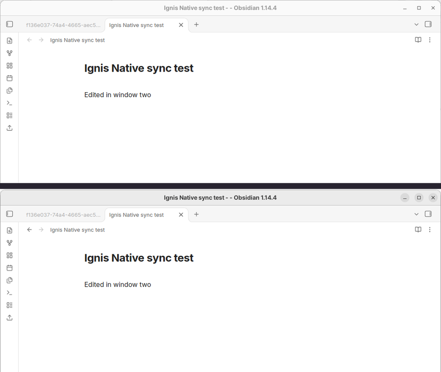
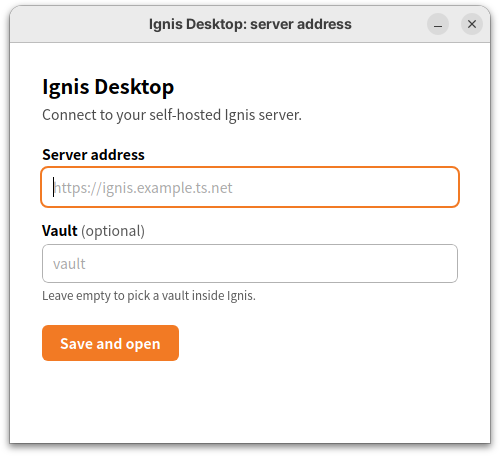

# Ignis Desktop

[](LICENSE)
[](../../releases)

Unofficial desktop app for Ignis — use your self-hosted Obsidian in multiple native windows (Windows, Linux)

Ignis Desktop is a real desktop app, not a browser tab. It opens your [Ignis](https://github.com/Nystik-gh/ignis) server in native OS windows, as many as you want, and every shortcut goes to Obsidian instead of the browser. There is no address bar, no tab strip and no browser menu. `Ctrl+P` opens the command palette, `Ctrl+W` closes an Obsidian tab, and `F5` does not reload the page under you.



How it compares with using Ignis in a browser:

| | Browser tab or PWA | Ignis Desktop |
| --- | --- | --- |
| Windows | Extra windows share one layout unless you add `?workspace=` to each URL by hand. | Any number of native windows. Each gets its own Ignis workspace automatically and is remembered between runs. |
| Shortcuts | The browser handles some keys first: `Ctrl+P` prints, `Ctrl+F` opens the browser's find bar, `Ctrl+R` reloads. | Browser shortcuts are off. The page gets every key. |
| Address bar and tabs | A browser always has them. A PWA hides them but a browser still owns the window. | None. |
| Memory | Shared with every other tab and extension. | Not measured. The app runs only Ignis, with no extensions or other tabs. |

## Table of Contents

- [Background](#background)
- [Install](#install)
- [Usage](#usage)
- [Requirements](#requirements)
- [Limitations](#limitations)
- [Building from source](#building-from-source)
- [Contributing](#contributing)
- [License](#license)

## Background

[Ignis](https://github.com/Nystik-gh/ignis) runs Obsidian on a server and serves it to a web browser. It supports several saved workspaces through the `?workspace=` URL parameter, opens notes directly through `?file=`, and keeps tabs in sync over a WebSocket. It has no pop-out windows.

Ignis Desktop uses those URL parameters to give you several real windows on one vault:

- The first window loads `?vault=<vault>`.
- Every other window loads `?vault=<vault>&workspace=<id>`, so the windows do not overwrite each other's layout.
- Edits made in one window show up in the others within about a second. That sync is Ignis's, not this app's.

The app only loads the URL of a server you run. It contains no Ignis or Obsidian code.

**Not affiliated with Ignis or Obsidian.** This is an independent project. "Obsidian" is a trademark of its owner and is used here only to describe what Ignis serves.

## Install

### Windows

1. Download the latest `.msi` (or the `.exe` installer) from the [Releases](../../releases) page.
2. Run it. The installers are not code-signed yet, so Windows SmartScreen may ask you to confirm: choose "More info", then "Run anyway".
3. Start **Ignis Desktop** from the Start menu.

The app uses the Microsoft Edge WebView2 runtime. It is preinstalled on Windows 11 and on current Windows 10.

### Linux

There is no prebuilt Linux package yet. [Build it from source](#building-from-source).

## Usage

### First run

The first start shows a small window.



It asks for:

- **Server address**, for example `https://ignis.example.ts.net`. If you leave out the scheme, `https://` is assumed.
- **Vault** (optional). Use the vault name from Ignis's `?vault=` URL parameter. Leave it empty to pick a vault inside Ignis.

Press *Save and open*. The settings are stored in `config.json`:

| OS | Location |
| --- | --- |
| Windows | `%APPDATA%\dev.philaxis.ignis-desktop\config.json` |
| Linux | `~/.config/dev.philaxis.ignis-desktop/config.json` |

To change the address later, use *Change server address…* in the tray menu. Open windows are pointed at the new server.

### Shortcuts

| Shortcut | Action |
| --- | --- |
| `Ctrl+Shift+N` | Open a new window with its own workspace. Works while the Ignis page has focus. |
| Any other key | Sent to the page, so it does whatever Obsidian binds it to. |

On Windows, the WebView2 accelerator keys (`Ctrl+F`, `Ctrl+R`, `Ctrl+P`, `Ctrl+U`, `F5`, `F12` and similar) are switched off with `AreBrowserAcceleratorKeysEnabled = false`, so the page receives them.

### Windows

- Open a new window with `Ctrl+Shift+N` or the tray menu.
- A page that opens a window with `window.open` or `target=_blank` gets a new native window. If the request points at a note, that window opens the note (`&file=<path>`). Links to other sites open in your system browser.
- All windows share one data folder, so settings the page stores in the browser (for example your plugin trust choice) apply to every window.
- Size, position and maximized state are saved for each window. Windows that are still open when you quit from the tray come back on the next start.
- Closing a window forgets it. Closing the last window quits the app. It does not stay in the tray.
- Each window id (`main`, `w2`, `w3`, …) maps to one Ignis workspace. A new window takes the lowest unused id, so a closed window's layout comes back when you open a new one. Ignis stores the layouts in the vault as `.obsidian/workspace.<id>.json`.

### Tray menu

| Item | Action |
| --- | --- |
| New window | Open another window. |
| Change server address… | Open the settings window. |
| Quit | Save all windows and exit. |

## Requirements

You need a running Ignis server that you can reach from the machine you install Ignis Desktop on.

- **HTTPS.** Outside a secure context, browsers and WebView2 turn off features Ignis needs. `http://localhost` and `http://127.0.0.1` count as secure, so a server on the same machine works over plain HTTP. Anything else should use HTTPS.
- **Authentication in front of Ignis.** Ignis has none. If a login page or single sign-on sits in front of it, that page loads in the window like any other.

[Tailscale](https://tailscale.com) gives you HTTPS and a private network in one step. On the machine that runs Ignis, which listens on port 8080:

```sh
tailscale serve --bg 8080
```

Tailscale prints the resulting address, something like `https://ignis.example.ts.net`. Enter that address in Ignis Desktop on any device in your tailnet.

## Limitations

- **Windows is the main target.** The app builds and runs on Linux, but there is no Linux package. macOS is untested. On Linux, WebKitGTK's own shortcuts are not changed.
- **The installers are unsigned.** Expect a SmartScreen prompt.
- **No pop-out windows.** Ignis opens notes as tabs and cannot move a tab into a new window. Ignis Desktop gives you more windows, each with its own workspace.
- **`Ctrl+Shift+N` needs the page.** A small script inside the page handles it. If Ignis is unreachable and the window shows an error page, use the tray menu.
- **Navigation is not restricted.** A plain link to another site that is not opened as a new window loads inside the window. This keeps login redirects working.
- **No auto-update.** Download new versions from the Releases page.
- **Ignis limits still apply.** Plugins that need Node, for example, do not work. See the [Ignis documentation](https://ignis.thiefling.com/docs/).

## Building from source

You need [Rust](https://rustup.rs) (stable), Node.js 22 and the [Tauri 2 prerequisites](https://tauri.app/start/prerequisites/) for your OS. On Debian or Ubuntu:

```sh
sudo apt install libwebkit2gtk-4.1-dev libgtk-3-dev libayatana-appindicator3-dev \
  librsvg2-dev libxdo-dev libssl-dev
```

Then:

```sh
npm ci
npm run tauri dev                                  # run a debug build
npm run tauri build -- --bundles msi               # Windows installer
cargo test --manifest-path src-tauri/Cargo.toml    # unit tests
```

GitHub Actions builds the releases. Pushing a tag such as `v0.1.0` runs [`release.yml`](.github/workflows/release.yml), which builds the Windows installers and attaches them to a draft release. You can also start the workflow by hand to get the installers as a build artifact.

### Checking keys on Windows

[`scripts/windows-keytest.ps1`](scripts/windows-keytest.ps1) starts the release build against a local test page, sends `Ctrl+P`, `Ctrl+F`, `F5`, `Ctrl+R`, `Ctrl+U` and `Ctrl+Shift+N`, and reports which keys the page saw and whether the page reloaded. It needs an interactive Windows desktop.

### Layout

| Path | What it does |
| --- | --- |
| `src-tauri/src/urls.rs` | Normalises the server address, builds window URLs and decides what a `window.open` request becomes. |
| `src-tauri/src/config.rs` | Reads and writes `config.json`: server, vault, open windows and their geometry. |
| `src-tauri/src/windows.rs` | Creates windows, tracks and restores geometry, handles new-window requests, sets the WebView2 shortcut option. |
| `src-tauri/src/main.rs` | App setup, tray menu and the two commands used by the settings page. |
| `ui/index.html` | The local first-run page. Ignis windows get no access to the app's IPC. |

## Contributing

Issues and pull requests are welcome. Before you open a pull request, run:

```sh
cargo fmt --manifest-path src-tauri/Cargo.toml
cargo clippy --manifest-path src-tauri/Cargo.toml --all-targets -- -D warnings
cargo test --manifest-path src-tauri/Cargo.toml
```

Please keep the unofficial notice and do not add Ignis or Obsidian code or assets.

## License

[MIT](LICENSE) © philaxis
