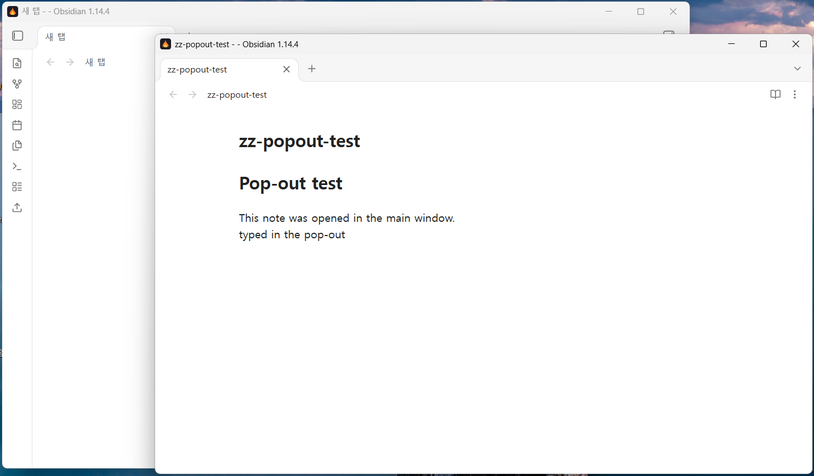
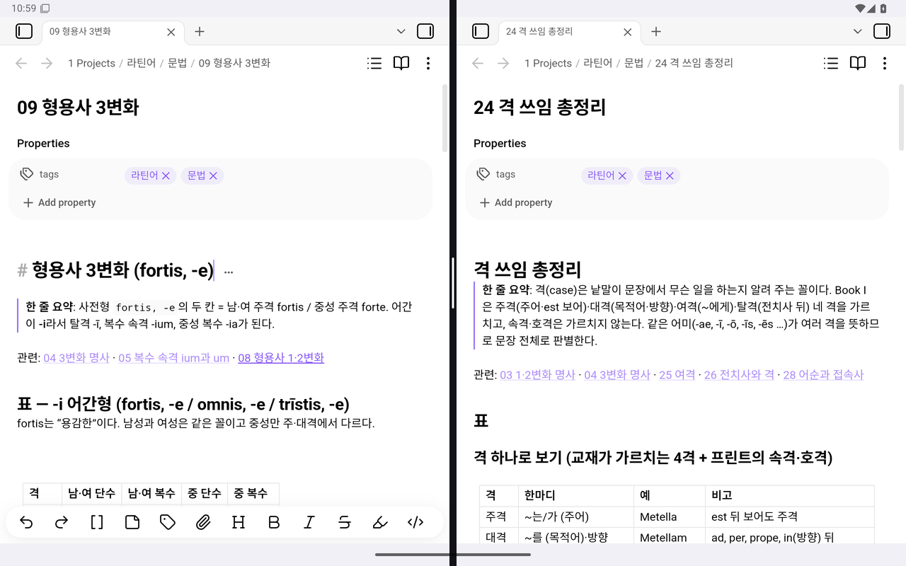

# Ignis Desktop

[](LICENSE)
[](../../releases)

Unofficial desktop app for Ignis — use your self-hosted Obsidian in multiple native windows (Windows, Linux)

Ignis Desktop is a real desktop app, not a browser tab. It opens your [Ignis](https://github.com/Nystik-gh/ignis) server in native OS windows, as many as you want, and every shortcut goes to Obsidian instead of the browser. There is no address bar, no browser tab strip, no browser menu and no separate title bar: Obsidian's own tab header is the title bar. `Ctrl+P` opens the command palette, `Ctrl+W` closes an Obsidian tab, and `F5` does not reload the page under you.




There is also an **Android tablet app**, [Ignis](#android-tablet), with the same idea for touch: no browser around Obsidian, Obsidian's own tablet layout on any screen size, and two windows side by side in split screen, each with its own workspace.



How it compares with using Ignis in a browser:

| | Browser tab or PWA | Ignis Desktop |
| --- | --- | --- |
| Windows | Extra windows share one layout unless you add `?workspace=` to each URL by hand. | Any number of native windows. Each gets its own Ignis workspace automatically and is remembered between runs. |
| Shortcuts | The browser handles some keys first: `Ctrl+P` prints, `Ctrl+F` opens the browser's find bar, `Ctrl+R` reloads. | Browser shortcuts are off. The page gets every key. |
| Address bar, tabs and title bar | A browser always has them. A PWA hides them but a browser still owns the window. | None. The window has no title bar of its own; you move it by the empty part of Obsidian's tab header. |
| Memory | Shared with every other tab and extension. | Not measured. The app runs only Ignis, with no extensions or other tabs. |
| Pop-out windows | Ignis turns them off. | *Move current tab to new window* opens a native window that belongs to the window it came from. |

## Table of Contents

- [Background](#background)
- [Install](#install)
- [Usage](#usage)
- [Requirements](#requirements)
- [Limitations](#limitations)
- [Building from source](#building-from-source)
- [Contributing](#contributing)
- [License](#license)

## Background

[Ignis](https://github.com/Nystik-gh/ignis) runs Obsidian on a server and serves it to a web browser. It supports several saved workspaces through the `?workspace=` URL parameter, opens notes directly through `?file=`, and keeps tabs in sync over a WebSocket. It switches Obsidian's pop-out windows off.

Ignis Desktop uses those URL parameters to give you several real windows on one vault:

- The first window loads `?vault=<vault>`.
- Every other window loads `?vault=<vault>&workspace=<id>`, so the windows do not overwrite each other's layout.
- Edits made in one window show up in the others within about a second. That sync is Ignis's, not this app's.

The app only loads the URL of a server you run. It contains no Ignis or Obsidian code.

**Not affiliated with Ignis or Obsidian.** This is an independent project. "Obsidian" is a trademark of its owner and is used here only to describe what Ignis serves.

## Install

### Windows

1. Download the latest `.msi` (or the `.exe` installer) from the [Releases](../../releases) page.
2. Run it. The installers are not code-signed yet, so Windows SmartScreen may ask you to confirm: choose "More info", then "Run anyway".
3. Start **Ignis Desktop** from the Start menu.

The app uses the Microsoft Edge WebView2 runtime. It is preinstalled on Windows 11 and on current Windows 10.

### Linux

There is no prebuilt Linux package yet. [Build it from source](#building-from-source).

### Android tablet

There is no prebuilt APK yet. [Build it from source](#building-the-android-app), copy the APK to the tablet, open it and allow installing from that source when Android asks. Then start **Ignis** and enter the server address and vault.

It needs Android 10 or later and an up-to-date Android System WebView.

## Usage

### First run

The first start shows a small window.


It asks for:

- **Server address**, for example `https://ignis.example.ts.net`. If you leave out the scheme, `https://` is assumed.
- **Vault** (optional). Use the vault name from Ignis's `?vault=` URL parameter. Leave it empty to pick a vault inside Ignis.

Press *Save and open*. The settings are stored in `config.json`:

| OS | Location |
| --- | --- |
| Windows | `%APPDATA%\dev.philaxis.ignis-desktop\config.json` |
| Linux | `~/.config/dev.philaxis.ignis-desktop/config.json` |

To change the address later, use *Change server address…* in the tray menu. Open windows are pointed at the new server.

### Shortcuts

| Shortcut | Action |
| --- | --- |
| `Ctrl+Shift+N` | Open a new window with its own workspace. Works while the Ignis page has focus. |
| Any other key | Sent to the page, so it does whatever Obsidian binds it to. |

On Windows, the WebView2 accelerator keys (`Ctrl+F`, `Ctrl+R`, `Ctrl+P`, `Ctrl+U`, `F5`, `F12` and similar) are switched off with `AreBrowserAcceleratorKeysEnabled = false`, so the page receives them.

### Windows

- Open a new window with `Ctrl+Shift+N` or the tray menu.
- Windows have no native title bar. Obsidian's tab header is the title bar:
  - Drag an empty part of the tab header to move the window; double-click it to maximize or restore.
  - Minimize, maximize and close sit at the right end of the header, in the place Obsidian's "Hidden" frame style gives them. They follow the theme colors.
  - Windows snap to the screen edges. On Windows 11, hovering the maximize button opens the Snap Layouts flyout.
  - The window borders still resize the window.
  - While the page is not there (still loading, server down, or an error page from a proxy), a thin strip along the top does the same job.
  - Choose *Use system title bar* in the tray menu to get the operating system's title bar back. It applies to windows you open afterwards.
- A page that opens a window with `window.open` or `target=_blank` gets a new native window. If the request points at a note, that window opens the note (`&file=<path>`). Links to other sites open in your system browser.
- **Pop-out windows** work. Run *Move current tab to new window* or *Open current tab in new window* from the command palette. A pop-out looks like the window it came from: no native title bar, the empty part of its tab header moves it, and the minimize, maximize and close buttons are drawn into it. With *Use system title bar* on, it has the operating system's title bar instead. It belongs to the window it came from: it is not saved with the window list, it has no workspace of its own, and it closes when that window closes. Closing it closes its tabs, as in desktop Obsidian. A pop-out's tab can be dragged back into the main window with *Use system title bar* on (see Limitations).
- All windows share one data folder, so settings the page stores in the browser (for example your plugin trust choice) apply to every window.
- Size, position and maximized state are saved for each window. Windows that are still open when you quit from the tray come back on the next start.
- Closing a window forgets it. Closing the last window quits the app. It does not stay in the tray.
- Each window id (`main`, `w2`, `w3`, …) maps to one Ignis workspace. A new window takes the lowest unused id, so a closed window's layout comes back when you open a new one. Ignis stores the layouts in the vault as `.obsidian/workspace.<id>.json`.

### Tray menu

| Item | Action |
| --- | --- |
| New window | Open another window. |
| Change server address… | Open the settings window. |
| Use system title bar | Checked: windows opened from now on have the operating system's title bar instead of Obsidian's tab header. Off by default. |
| Quit | Save all windows and exit. |

### Android tablet

The Android app shows Obsidian's own tablet layout, the one Obsidian's Android app uses: the sidebars open as drawers (tap the sidebar button or swipe across the note), menus open with a long press, and while you type an editing toolbar sits above the keyboard. Ignis on its own shows this layout only on screens narrower than 600 pixels; the app keeps it on a tablet.

- **Back** closes the open menu, drawer or dialog first, then goes back in the note's history, then leaves the app.
- **Two windows side by side.** Run *Open a new window* from the command palette (or press `Ctrl+Shift+N` on a keyboard), or long-press the app icon and choose *New window*. On a large screen the new window opens next to the current one in split screen. You can also use Android's own split screen and taskbar.
- **Each window has its own workspace**, `tablet`, `tablet-2`, …, so the windows do not overwrite each other's tabs. A new window takes the lowest free one, so a closed window's tabs come back in the next window you open. Obsidian keeps a tablet layout in `.obsidian/workspace-mobile.<id>.json`; desktop windows and phones that use Ignis in a browser keep theirs.
- **Server address and vault.** The first screen asks for the server address and lists the server's vaults to pick from; Ignis opens its first vault when none is named, so the app always names one. To change them later, long-press the app icon and choose *Server address*, or use the button on the page shown while the server cannot be reached. A link `dev.philaxis.ignis://settings?server=<address>&vault=<vault>` opens the same screen with both filled in.
- Rotating the tablet or resizing a split-screen window does not reload Obsidian.
- Links to other sites open in the browser. Plugins that record audio may use the microphone; Android asks once.

## Requirements

You need a running Ignis server that you can reach from the machine you install Ignis Desktop on.

- **HTTPS.** Outside a secure context, browsers and WebView2 turn off features Ignis needs. `http://localhost` and `http://127.0.0.1` count as secure, so a server on the same machine works over plain HTTP. Anything else should use HTTPS.
- **Authentication in front of Ignis.** Ignis has none. If a login page or single sign-on sits in front of it, that page loads in the window like any other.

[Tailscale](https://tailscale.com) gives you HTTPS and a private network in one step. On the machine that runs Ignis, which listens on port 8080:

```sh
tailscale serve --bg 8080
```

Tailscale prints the resulting address, something like `https://ignis.example.ts.net`. Enter that address in Ignis Desktop on any device in your tailnet.

## Limitations

- **Windows is the main target.** The app builds and runs on Linux, but there is no Linux package. macOS is untested. On Linux, WebKitGTK's own shortcuts are not changed.
- **The installers are unsigned.** Expect a SmartScreen prompt.
- **A reload with the server down can lose the controls.** A window starts on a small local page that waits for the server. If you reload an open Ignis window while the server is down, the web view may replace the page with its own error page, which has no window controls. Close the window from the taskbar or with `Alt+F4`.
- **Pop-outs are not restored after a restart.** Ignis removes saved pop-out windows from the layout when it reads it. A pop-out you left open is gone the next time you start the app; its tabs are not lost from the vault.
- **Pop-outs rely on Ignis internals.** `popout.js` undoes what Ignis 0.9 does to switch pop-outs off. A later Ignis version that changes that code may turn them off again. See [`docs/upstream-popout.md`](docs/upstream-popout.md).
- **Dragging a tab from a pop-out back to the main window does not work with the custom title bar; turn on 'Use system title bar' if you need it.** It works with the system title bar on Windows (`windows-popouttest.ps1 -SystemTitleBar`). The cause is not known: the drop lands on the main window's tab header and nothing happens; it is not the pop-out's frame script.
- **Linux: dragging a tab between windows does not work.** Dropping a tab on another window ends in an Ignis notice about files outside the vault instead of moving the tab. Use *Move current tab to new window* to pop a tab out. 
- **`Ctrl+Shift+N` needs the page.** A small script inside the page handles it. If Ignis is unreachable and the window shows an error page, use the tray menu.
- **Navigation is not restricted.** A plain link to another site that is not opened as a new window loads inside the window. This keeps login redirects working.
- **No auto-update.** Download new versions from the Releases page.
- **Ignis limits still apply.** Plugins that need Node, for example, do not work. See the [Ignis documentation](https://ignis.thiefling.com/docs/).
- **Android: the tablet layout and the per-window workspaces rely on Ignis internals.** The app keeps the `EmulateMobile` flag that Ignis 0.9 removes on wide screens, and redirects Obsidian's `workspace-mobile.json` per window. A later Ignis or Obsidian version that changes either may show the desktop layout or share one layout between windows.
- **Android: no pop-outs.** Obsidian's tablet layout has none; use a second window instead.
- **Android: the edge of the screen belongs to Android.** With gesture navigation a swipe that starts at the very edge is Android's Back gesture. Start the swipe that opens a drawer a little further in.

## Building from source

You need [Rust](https://rustup.rs) (stable), Node.js 22 and the [Tauri 2 prerequisites](https://tauri.app/start/prerequisites/) for your OS. On Debian or Ubuntu:

```sh
sudo apt install libwebkit2gtk-4.1-dev libgtk-3-dev libayatana-appindicator3-dev \
  librsvg2-dev libxdo-dev libssl-dev
```

Then:

```sh
npm ci
npm run tauri dev                                  # run a debug build
npm run tauri build -- --bundles msi               # Windows installer
cargo test --manifest-path src-tauri/Cargo.toml    # unit tests
```

GitHub Actions builds the releases. Pushing a tag such as `v0.1.0` runs [`release.yml`](.github/workflows/release.yml), which builds the Windows installers and attaches them to a draft release. You can also start the workflow by hand to get the installers as a build artifact.

### Building the Android app

The Android app is a small Kotlin app in [`android/`](android). It does not use Tauri: it is one WebView per window, and Android's own tasks give it several windows. You need JDK 17 or later and the Android SDK (platform 35).

```sh
cd android
./gradlew testDebugUnitTest    # unit tests
./gradlew assembleDebug        # app/build/outputs/apk/debug/app-debug.apk
```

`./gradlew assembleRelease` signs the release APK when `IGNIS_ANDROID_KEYSTORE`, `IGNIS_ANDROID_KEYSTORE_PASSWORD`, `IGNIS_ANDROID_KEY_ALIAS` and `IGNIS_ANDROID_KEY_PASSWORD` are set; otherwise it leaves it unsigned. Keep the same key for every build, or Android refuses to update the installed app.

### Checking keys on Windows

[`scripts/windows-keytest.ps1`](scripts/windows-keytest.ps1) starts the release build against a local test page, sends `Ctrl+P`, `Ctrl+F`, `F5`, `Ctrl+R`, `Ctrl+U` and `Ctrl+Shift+N`, and reports which keys the page saw and whether the page reloaded. It needs an interactive Windows desktop.

### Checking the window frame on Windows

[`scripts/windows-frametest.ps1`](scripts/windows-frametest.ps1) serves a page with Obsidian's tab header structure, starts the release build against it and drives the mouse: drag, double-click, the three buttons, snapping to the left, right and top screen edges, hovering the maximize button, and the strip when the server is down. It writes `frametest-out\report.txt` and screenshots. It needs an interactive Windows desktop.

### Checking pop-outs on Windows

[`scripts/windows-popouttest.ps1`](scripts/windows-popouttest.ps1) starts the release build against a real Ignis server (`-Server https://…`), pops a throw-away note out into its own window, types into it, closes it, drags the tab back, and closes the main window while a pop-out is open. It uses the WebView2 debugging port to run Obsidian commands and reads the answers back, and writes a report and screenshots to `popouttest-out`. The note is deleted at the end; delete `workspace.popouttest.json` from the vault yourself. It needs an interactive Windows desktop.

### Layout

| Path | What it does |
| --- | --- |
| `src-tauri/src/urls.rs` | Normalises the server address, builds window URLs and decides what a `window.open` request becomes (pop-out, new window, system browser). |
| `src-tauri/src/config.rs` | Reads and writes `config.json`: server, vault, open windows and their geometry. |
| `src-tauri/src/windows.rs` | Creates windows, tracks and restores geometry, handles new-window requests, sets the WebView2 shortcut option. |
| `src-tauri/src/frame.rs`, `src-tauri/src/frame.js` | The window frame: the commands that move, minimize, maximize and close the calling window, the capability that lets only the configured server's origin use them, and the script that draws the controls into Obsidian's tab header. |
| `src-tauri/src/snap.rs` | Windows only: the child window over the maximize button that makes Snap Layouts appear. |
| `src-tauri/src/popout.rs` | Creates pop-out windows as child webviews of the page that asked, closes them with their owner, and runs the frame commands for their buttons. |
| `src-tauri/src/popout.js` | Page side: turns Obsidian's pop-outs back on, which Ignis switches off, and draws the frame into a pop-out's document. Runs in every Ignis window. |
| `src-tauri/src/main.rs` | App setup, tray menu and the commands used by the settings page. |
| `ui/index.html` | The local first-run page. |
| `ui/connect.html` | The page every window starts on. It waits for the server to answer, then opens it. |
| `android/app/src/main/java/dev/philaxis/ignis/MainActivity.kt` | Android: one window. The WebView, the start script, new-window requests, file picking, the microphone and Back. |
| `android/app/src/main/java/dev/philaxis/ignis/Urls.kt`, `WindowIds.kt` | Android: the same URL rules as `urls.rs`, and the workspace id of each window. |
| `android/app/src/main/java/dev/philaxis/ignis/SettingsActivity.kt` | Android: the server-address screen. |
| `android/app/src/main/assets/tablet.js` | Android, page side: keeps Obsidian's tablet layout, gives each window its own `workspace-mobile` file, and adds *Open a new window*. Runs before Ignis's own scripts. |

## Contributing

Issues and pull requests are welcome. Before you open a pull request, run:

```sh
cargo fmt --manifest-path src-tauri/Cargo.toml
cargo clippy --manifest-path src-tauri/Cargo.toml --all-targets -- -D warnings
cargo test --manifest-path src-tauri/Cargo.toml
```

Please keep the unofficial notice and do not add Ignis or Obsidian code or assets.

## License

[MIT](LICENSE) © philaxis
